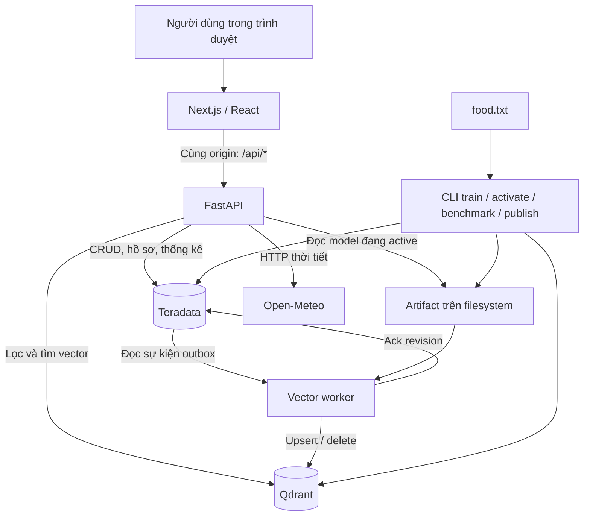
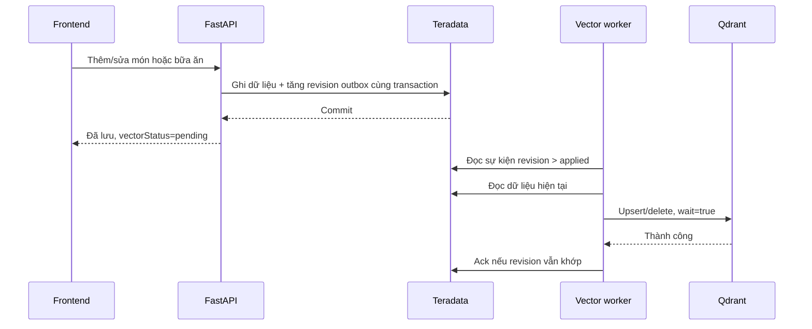

# OfficeLunch — Kiến trúc và chức năng dự án

Tài liệu dành cho người muốn hiểu dự án từ mục đích sử dụng đến cách hệ thống xử lý dữ liệu. Nội dung được đối chiếu với mã nguồn trong repository ngày **06-11-2026**. Trạng thái triển khai được dẫn từ biên bản nghiệm thu trong repo; lần biên soạn này không kiểm tra lại hệ thống đang chạy.

## 1. Dự án giải quyết vấn đề gì?

OfficeLunch là ứng dụng thử nghiệm giúp nhân viên văn phòng chọn bữa trưa dựa trên khẩu vị, lịch sử phản hồi và ngữ cảnh trong ngày. Người dùng có thể quản lý món, ghi lại bữa ăn, đánh dấu thích/không thích và xem thống kê.

Song song với ứng dụng, dự án có bộ thực nghiệm học máy và cơ sở dữ liệu: chuyển giao dịch món ăn thành vector, đánh giá phân loại yes/no, rồi so sánh tìm kiếm vector bằng Teradata SQL với Qdrant. Hai phần dùng chung một số dữ liệu và artifact, nhưng có mục tiêu đánh giá khác nhau.

| Phần | Câu hỏi cần trả lời | Đầu ra |
|---|---|---|
| Ứng dụng | Hôm nay nên chọn món nào trong các điều kiện đang có? | Danh sách món, gợi ý đồ uống, lịch sử và thống kê |
| Đánh giá mô hình | Biểu diễn giao dịch nào dự đoán nhãn tốt hơn? | Accuracy, Macro-F1, confusion matrix theo seed |
| Benchmark database | Cùng vector và truy vấn, mỗi cách tìm kiếm nhanh và chính xác đến đâu? | Latency, QPS, error rate, Recall@15 và chất lượng kNN |

Đây là ứng dụng demo/nghiên cứu. Repository chưa triển khai đăng nhập, phân quyền, đặt món, thanh toán, quản lý nhà hàng hoặc giao hàng.

## 2. Cách đọc dữ liệu của dự án

Có ba nguồn cần phân biệt:

- **Dữ liệu nghiên cứu `food.txt`:** mỗi dòng gồm nhãn `yes`/`no` và danh sách mã item. Mã số không cung cấp tên món, nguyên liệu hay giá bán.
- **Metadata demo `backend/data/demo.json`:** bổ sung user, tên món, giá, tag, nhóm món và lịch sử mẫu để xây dựng giao diện. Các thông tin này là synthetic, không phải ý nghĩa đã được xác minh của mã item trong food.
- **Dữ liệu ứng dụng:** hồ sơ được chỉnh sửa và bữa ăn do người dùng ghi qua API. Bữa ăn mới có `source=app`; dữ liệu mẫu được đánh dấu `source=synthetic`. Món được ghi qua API cũng dùng metadata synthetic.

Item chưa được gán metadata có tên dạng `Item #…`, `categoryId=null` và `source=unmapped`. Item có vector nhưng chưa được gán nhóm vẫn không đủ điều kiện xuất hiện trong gợi ý.

**Hệ quả:** gợi ý có thể minh họa đúng luồng xử lý kỹ thuật, nhưng chưa chứng minh hệ thống hiểu nguyên liệu hoặc khẩu vị ẩm thực ngoài đời. Nhãn yes/no của dataset cũng không phải phản hồi thực của user đang chọn trên giao diện.

## 3. Kiến trúc tổng thể



### 3.1. Frontend

Frontend dùng Next.js 15.5.4, React 19.1, TypeScript và Tailwind CSS 4. Các màn hình tương tác chạy phía trình duyệt, gọi API qua lớp dùng chung `src/lib/api.ts`.

Next.js rewrite `/api/*` đến FastAPI. Nhờ đó trình duyệt chỉ cần truy cập một địa chỉ frontend; credentials của database nằm ở backend. `BACKEND_URL` được cố định khi build, nên đổi địa chỉ backend cần build lại frontend.

### 3.2. Backend

Backend dùng Python 3.11 và FastAPI. Trách nhiệm gồm kiểm tra input, xử lý nghiệp vụ, transaction SQL, tìm vector, trả thống kê và đọc kết quả thực nghiệm. API chạy một Uvicorn worker; giới hạn bốn thread xử lý route đồng bộ, pool Teradata tối đa bốn kết nối.

Phân chia mã nguồn:

| Module | Trách nhiệm |
|---|---|
| `api.py`, `models.py` | HTTP endpoint, schema input, ánh xạ lỗi |
| `service.py` | CRUD, hồ sơ, affinity, thống kê và gợi ý |
| `db.py`, `schema.py` | Kết nối/pool, transaction, truy vấn và tạo bảng |
| `ingest.py` | Import dataset, metadata demo, tạo sự kiện outbox |
| `pipeline.py`, `numerics.py` | Huấn luyện, chia train/test, kiểm tra runtime tính toán |
| `vector.py` | Load/activate model, Qdrant, đồng bộ outbox, publish kết quả |
| `benchmark.py` | Thực nghiệm SQL exact, Qdrant exact và ANN |
| `cli.py` | Điểm chạy tác vụ ngoài HTTP |
| `build.py`, `config.py` | Thông tin build và cấu hình môi trường |

### 3.3. Teradata

Teradata giữ dữ liệu nghiệp vụ gốc: user, món, bữa ăn, phản hồi và trạng thái đồng bộ. Các phép tổng hợp thống kê thực hiện bằng SQL. Teradata cũng lưu dữ liệu nghiên cứu, vector theo từng chiều và summary kết quả để phục vụ thực nghiệm.

Một số thuộc tính được tách thành cột để lọc/join/tổng hợp; phần còn lại lưu JSON trong cột `doc`. Vì thế đây là thiết kế kết hợp cột quan hệ và document JSON, không phải toàn bộ dữ liệu đều được chuẩn hóa thành bảng con.

### 3.4. Qdrant

Qdrant phục vụ tìm kiếm tương đồng cosine và lọc payload theo giá, tag, nhóm món, trạng thái active và phiên bản model. Dữ liệu vector là bản dẫn xuất; Qdrant không thay Teradata làm nguồn dữ liệu nghiệp vụ gốc.

Mỗi model có hai collection phục vụ có tên gắn phiên bản:

- **Dishes:** vector item cùng metadata phục vụ lọc món.
- **Transactions:** vector giao dịch train của food và vector bữa ăn ứng dụng được worker đồng bộ; dùng truy vấn kNN yes/no.

Bởi collection transactions có thể nhận thêm lịch sử app, dự đoán trực tuyến có thể khác kết quả benchmark trên corpus nghiên cứu cố định.

### 3.5. Artifact và CLI

Artifact nằm trên filesystem, gồm model Doc2Vec, split, frequent itemsets, vector, manifest, phiên bản thư viện và kết quả thô. SQL lưu summary để API đọc; không lưu toàn bộ file model.

`active.json` xác định run, seed, modelVersion và hai collection đang phục vụ. API và worker phải đọc cùng bộ artifact tương ứng với namespace Qdrant. Training/benchmark chạy qua CLI, không chạy trong HTTP request.

## 4. Chi tiết các chức năng

### 4.1. Chọn người dùng demo

Giao diện cho chọn user có sẵn, lưu ID trong localStorage và gửi header `x-user-id` khi gọi API. Bỏ header thì backend dùng `u-001`; ID không tồn tại trả 404.

Đổi user giúp xem hồ sơ, lịch sử và thống kê tương ứng. Đây là cơ chế mô phỏng nhiều người dùng, chưa có đăng nhập. Kiểm tra bữa ăn thuộc user chỉ dựa trên ID được gửi lên, nên không tạo thành cơ chế bảo vệ tài khoản.

### 4.2. Gợi ý bữa trưa — `/`

Người dùng điều chỉnh thời tiết, ngân sách, thời gian nghỉ và nhu cầu ăn. Frontend mặc định xin tối đa bốn gợi ý, gồm một món nổi bật và các lựa chọn khác.

| Đầu vào | Hành vi backend hiện tại |
|---|---|
| Ngân sách `duoi-35` | Giá món chính không quá 35.000 đồng |
| Ngân sách `35-50` | Giá món chính không quá 50.000 đồng; không đặt cận dưới 35.000 |
| Ngân sách `tren-50` | Không áp trần giá; không bắt buộc giá trên 50.000 |
| Nghỉ 15 phút | Bắt buộc tag `nhanh` |
| Nghỉ 30 hoặc 60 phút | Chưa có bộ lọc thời gian bổ sung |
| Ăn nhẹ | Bắt buộc tag `nhẹ` |
| No bụng | Bắt buộc tag `no-lau` |
| Healthy | Bắt buộc tag `healthy` |
| Gì cũng được | Không thêm tag theo mood |
| Ăn chay trong hồ sơ | Bắt buộc tag `chay` |
| Ít tinh bột trong hồ sơ | Bắt buộc tag `healthy` |
| Danh sách không ăn được | Loại món có bất kỳ tag trùng danh sách |
| Nắng nóng | Ưu tiên nhẹ món có tag `lạnh` |
| Mưa hoặc mát | Ưu tiên nhẹ món có tag `nóng` |

Các điều kiện tag được kết hợp đồng thời. Nếu một món không đáp ứng đủ thì bị loại, vì vậy kết quả có thể ít hơn số lượng yêu cầu hoặc rỗng. Đây là kiểm tra metadata, chưa phân tích nguyên liệu thực tế.

Các thao tác trên gợi ý:

- **Chọn món:** ghi một bữa ăn nhãn `yes`, gồm món chính và đồ uống đi kèm nếu có.
- **Bỏ qua:** thêm món vào danh sách loại trừ của lượt chọn hiện tại, không ghi phản hồi không thích.
- **Không thích:** ghi bữa ăn nhãn `no` cho món chính, rồi loại món khỏi lượt gợi ý.
- **Gợi ý lại từ đầu:** xóa danh sách loại trừ hiện tại.

Không có nghiệp vụ đặt đơn khi bấm chọn món. Nhãn yes trên lịch sử đồng thời được dùng cho lựa chọn tích cực; không có trường riêng xác nhận đã ăn thực tế.

### 4.3. Hồ sơ khẩu vị — `/profile`

Cho phép chỉnh tên hiển thị, chế độ ăn, mức cay 0–3, ngân sách thường ngày, tag cần tránh và danh sách món yêu thích. API còn hỗ trợ cập nhật `team`.

Món yêu thích và lịch sử yes/no được dùng để tạo vector khẩu vị. Chế độ ăn và tag cần tránh dùng để lọc. Mức cay được lưu nhưng chưa tham gia thuật toán xếp hạng/lọc. Ngân sách hồ sơ là giá trị khởi tạo trên trang gợi ý; backend dùng ngân sách gửi trong context của request.

Biểu đồ “hợp nhóm món nào” tính điểm affinity theo cụm: mỗi lượt xuất hiện món trong bữa yes cộng 1, trong bữa no trừ 1, món yêu thích cộng 2. Chỉ món đã có cluster mới tham gia. Affinity là thống kê giải thích, không phải điểm cosine dùng xếp hạng gợi ý.

### 4.4. Lịch sử bữa ăn — `/history`

Người dùng có thể thêm, sửa, xóa bữa ăn và đổi riêng nhãn yes/no. Một bữa gồm ngày, danh sách item, nhãn và context tùy chọn. Backend kiểm tra món tồn tại, còn active và bữa ăn thuộc user đang chọn.

Trang hiển thị số bản ghi, tỷ lệ yes, số món khác nhau, nội dung từng bữa và biểu diễn dạng dòng giao dịch. `vectorStatus=pending` báo SQL đã lưu nhưng worker chưa xác nhận bản vector mới.

Thay đổi lịch sử tác động đến vector khẩu vị trong các request gợi ý tiếp theo. Việc cập nhật vector bữa ăn trong collection transactions diễn ra sau qua worker. Hệ thống không tự huấn luyện lại Doc2Vec khi thêm hoặc đổi nhãn một bữa ăn.

### 4.5. Quản lý món — `/dishes`

Hỗ trợ xem danh sách, tìm theo tên/mã, lọc theo nhóm, thêm/sửa metadata và xóa món. Metadata gồm mã item, tên, giá, nhóm thủ công, tags và URL ảnh.

Các quy tắc chính:

- `itemId` là số nguyên dương và không đổi khi sửa; thêm mã đã tồn tại trả 409.
- `categoryId` ghi qua API nằm trong 0–6; nhóm 6 được dùng làm đồ uống.
- Món có trong bất kỳ lịch sử bữa ăn nào không được xóa, API trả 409.
- Xóa món là đánh dấu không active trong SQL, sau đó worker xóa point tương ứng.
- Món mới ngoài vocabulary của model vẫn lưu được nhưng chưa có embedding; giữ pending đến khi có model phù hợp. Đổi tên/tag không tạo embedding từ văn bản.

Một số chữ “cụm” trên form/lọc món hiện trỏ đến category thủ công. Cụm học máy là `clusterId`, có ý nghĩa khác. Bộ đếm “đã gán tên” trên trang hiện đếm danh sách món API trả về, gồm cả item chưa mapping; không nên dùng làm tỷ lệ hoàn thành gán tên chính xác.

### 4.6. Khám phá cụm — `/clusters`

Mỗi chấm biểu diễn một item có cluster và đã synced. Màu là cụm KMeans; vị trí hai chiều do PCA từ vector item. Người dùng có thể chọn cụm, xem món trong cụm, hover để xem tên/giá và nhận biết item xuất hiện trong lịch sử qua vòng tròn viền.

Pipeline tạo tối đa bảy cụm. Cụm không được gán sẵn nghĩa như “món nước” hoặc “món chay”. Khoảng cách trên hình PCA có thể biến dạng so với vector gốc; truy vấn tương đồng vẫn dùng vector đầy đủ.

### 4.7. Thống kê — `/stats`

API tính từ lịch sử user trong Teradata: tổng số bữa, tỷ lệ yes, chi phí tuần hiện tại, chi phí tối đa tám tuần gần nhất có dữ liệu, top sáu món chính theo tần suất và số bữa yes/no theo cluster.

Chi phí được tính bằng cách join với **giá hiện tại của món**, chưa có snapshot giá tại thời điểm ghi bữa. Sửa giá món có thể làm thay đổi thống kê lịch sử. Với biểu đồ cluster, một bữa có nhiều món cùng cụm chỉ được tính một lần cho cụm đó. Lịch sử nghiên cứu food không được cộng vào số bữa của user.

### 4.8. Đánh giá và benchmark — `/evaluation`

Màn hình chỉ đọc kết quả đã publish. Phần mô hình hiển thị kết quả trung bình theo phương pháp, từng seed, confusion matrix, checksum dataset và cấu hình run. Phần database hiển thị từng lượt đo của ba engine, concurrency, latency, QPS, lỗi, recall và chất lượng phân loại kNN.

Chưa có kết quả thì hiển thị chưa chạy, không thay bằng số giả. Không có nút/API chạy training hoặc benchmark. Evaluation và benchmark có thể thuộc những training run khác nhau; phải đọc `trainingRunId` và cảnh báo của từng benchmark.

### 4.9. Thời tiết

Backend lấy nhiệt độ, lượng mưa và weather code từ Open-Meteo cho TP.HCM, Hà Nội hoặc Đà Nẵng. Frontend điền sẵn context thời tiết; người dùng vẫn có thể đổi tay.

Nếu dịch vụ ngoài lỗi, API trả fallback 32°C, nắng nóng với `source=fallback` và mô tả không lấy được thời tiết. Fallback không phải số đo hiện tại.

### 4.10. Xem truy vấn và phiên bản build

Khung “Xem truy vấn” đọc header `x-ol-queries`, hiển thị SQL template hoặc thao tác Qdrant, thời gian và số dòng/point quan sát được. Bind values SQL và API key được ẩn; đây là khung quan sát có giới hạn, không phải audit log đầy đủ. Header tối đa 6 KB và frontend giữ tối đa 40 entry.

Frontend có `/build-info`; backend có `/api/version` và thông tin build trong liveness. Commit, thời điểm build và dirty state giúp đối chiếu bản frontend/backend khi vận hành.

## 5. Luồng thuật toán gợi ý

### 5.1. Tạo vector khẩu vị

Backend đọc món yêu thích cùng tối đa 20 bữa gần nhất của mỗi thành viên. Các item trong bữa yes là tín hiệu tích cực, trong bữa no là tín hiệu tiêu cực. Món chính có embedding trong tín hiệu tích cực tạo vector trung bình; nếu có tín hiệu âm, trừ thêm 0,25 lần vector âm trung bình, rồi chuẩn hóa.

```text
vector khẩu vị = normalize(mean(vector tích cực) − 0,25 × mean(vector tiêu cực))
```

Phần âm chỉ áp dụng khi đã có vector tích cực. User chỉ có phản hồi no vẫn đi vào cold start. Đây là phép tổng hợp item vector, không phải một model cá nhân được train riêng cho từng người.

API hỗ trợ `members` để gộp tín hiệu nhiều hồ sơ và hợp danh sách tag cần tránh. Chỉ cần một thành viên ăn chay/ít tinh bột thì điều kiện tag tương ứng được áp dụng cho cả nhóm. Trang chủ hiện chưa có bộ chọn thành viên; `groupSize` chỉ là metadata, không tự xác định thành viên, chia khẩu phần hay nhân ngân sách.

### 5.2. Lọc và xếp hạng món

Backend truy vấn Qdrant theo model đang active, chỉ lấy item active, mapped, không phải đồ uống và đáp ứng điều kiện context/hồ sơ. Với vector khẩu vị hợp lệ, lấy tối đa `limit × 4` ứng viên rồi xếp lại bằng cosine cộng ưu tiên thời tiết 0,03.

Trường `score` trả về vẫn là cosine ban đầu, không cộng điểm thời tiết và không phải xác suất người dùng sẽ thích. Vì thế thứ tự món có thể khác thứ tự score thuần túy.

Khi chưa có vector khẩu vị, backend lọc point đủ điều kiện rồi xếp theo tần suất item trong dữ liệu nghiên cứu; `score=null`. Nhánh cold start hiện chỉ scroll tối đa 2.000 point trong một lần.

Sau tìm kiếm, backend kiểm tra lại metadata trong Teradata để loại món không còn đáp ứng ràng buộc trong lúc outbox chờ xử lý. Cách này giảm tác động metadata cũ, nhưng không bù thêm ứng viên đã bị loại; kết quả có thể thiếu món hoặc chưa phản ánh ngay món mới đủ điều kiện.

### 5.3. Dự đoán yes/no và gợi ý đồ uống

Với từng món chính, backend dùng vector item tìm 15 giao dịch gần nhất trong collection transactions. Nhãn dự đoán là đa số yes/no; hòa phiếu trả no. Đây là **kNN trực tuyến**, khác classifier LinearSVC dùng trong bảng đánh giá mô hình.

Đồ uống được chọn từ luật item đồng xuất hiện: chọn đồ uống active có confidence cao nhất cho món chính và không trùng tag cần tránh. Confidence là tỷ lệ đồng xuất hiện trong dữ liệu nghiên cứu, không phải xác suất thích của cá nhân.

Luật đồ uống được tính lúc import trên toàn bộ food, với ý nghĩa “đồ uống” dựa vào metadata demo. Luật này khác frequent itemsets chỉ khai phá trên train trong pipeline đánh giá. Đồ uống đi kèm hiện chưa được kiểm tra đầy đủ theo ngân sách tổng combo hoặc mọi tag context/chế độ ăn của món chính.

## 6. Mô hình dữ liệu

Schema ứng dụng mặc định là `officelunch`, gồm 12 bảng:

| Bảng | Vai trò và quan hệ logic |
|---|---|
| `users` | Hồ sơ user, khóa `entity_id` |
| `dishes` | Danh mục item, giá, category, cluster, active flag và JSON metadata |
| `meals` | Bữa ăn có user, ngày, nhãn và JSON context/itemIds |
| `meal_items` | Các item theo vị trí trong từng bữa, dùng join/thống kê |
| `research_transactions` | Giao dịch gốc, dataset hash và nhãn |
| `research_items` | Tập item của từng giao dịch nghiên cứu |
| `outbox` | Revision cần đồng bộ, revision đã áp dụng, số lần thử và lỗi gần nhất |
| `item_rules` | Luật món → đồ uống: số lần đồng xuất hiện, confidence |
| `vectors` | Component vector theo run/entity/dimension để tính exact SQL |
| `benchmark_queries` | Component vector query benchmark |
| `results` | Summary evaluation/benchmark đã publish |
| `imports` | Manifest import và checksum dataset |

Quan hệ user–meal–item được kiểm tra trong code nghiệp vụ; schema hiện không khai báo foreign key. `UNIQUE PRIMARY INDEX` xác định khóa duy nhất của từng bảng. Các cột quan hệ và JSON liên quan được ghi trong cùng transaction của thao tác tương ứng.

## 7. Vì sao cần outbox worker?

Ghi SQL và ghi Qdrant là hai thao tác trên hai hệ thống khác nhau. Nếu API ghi trực tiếp cả hai, có thể xảy ra SQL thành công nhưng Qdrant lỗi. Dự án giải quyết bằng transactional outbox:



Worker xử lý tuần tự, mỗi batch tối đa 100 sự kiện, lặp sau khoảng 5 giây. Outbox giữ trạng thái mới nhất theo entity, không phải nhật ký bất biến của mọi thay đổi. Worker đọc dữ liệu hiện tại thay vì dùng body cũ trong event; chỉ ack revision mà nó đã xử lý để không vô tình xác nhận một cập nhật mới hơn.

Nếu Qdrant lỗi, SQL vẫn giữ dữ liệu, outbox ghi attempts/lỗi và được thử lại. Nếu item không có vector hoặc bữa ăn suy luận ra vector zero, sự kiện giữ pending; worker không sinh vector ngẫu nhiên để vượt trạng thái này.

File lock chỉ điều phối các process dùng cùng artifact directory trên cùng máy/filesystem thích hợp. Không có distributed lock giữa hai máy độc lập, nên vận hành **một worker cho một namespace**. Readiness cũng chưa kiểm tra worker còn sống hoặc outbox đã hết pending.

## 8. Pipeline huấn luyện và đánh giá

Luồng chính: `food.txt → split → frequent itemsets → biểu diễn vector → classifier → artifact → activate/publish`.

1. Đọc dataset và tính SHA-256 để nhận diện chính xác dữ liệu.
2. Với mỗi seed, dùng `StratifiedGroupKFold(n_splits=5)` và lấy một fold test; các giao dịch có cùng tập item được gom nhóm để tránh nằm ở cả train lẫn test. Đây không phải chạy đủ năm fold cho mỗi seed.
3. Chỉ dùng train để khai phá frequent itemsets bằng FP-growth và fit vocabulary/Doc2Vec.
4. Đánh giá ba cách biểu diễn bằng LinearSVC: Bag-of-items; Trans2Vec-Ind với hai Doc2Vec riêng cho item và frequent itemset rồi lấy trung bình; Trans2Vec-Joi với token item và frequent itemset chung một model.
5. Suy luận vector test bằng model đã train, không train thêm trên test. Lưu Accuracy, Macro-F1, confusion matrix và thời gian theo seed.
6. Từ model Joi, suy luận vector singleton item, chuẩn hóa, chạy KMeans và PCA để chuẩn bị phục vụ giao diện.
7. Chỉ sau khi toàn bộ run hoàn tất mới ghi manifest `status=complete`.

Mặc định: 10 seed, 128 chiều, 50 epoch, minsup 0,006, Doc2Vec DBOW một worker. Đó là bản triển khai thích nghi trong dự án, không tuyên bố tái lập nguyên trạng bài báo Trans2Vec.

Artifact mỗi run gồm `manifest.json`, thư mục `seed-*` với `patterns.json`, `split.json`, ba file model, `vectors.npz` và `items.npz`. Run ID mới là bắt buộc để tránh ghi đè kết quả.

`activate` kiểm tra manifest và checksum dataset, chuẩn bị collection theo phiên bản, cập nhật cluster/toạ độ SQL, enqueue đồng bộ, publish evaluation rồi ghi `active.json`. Cơ chế này giảm khả năng đưa collection chưa chuẩn bị vào phục vụ nhưng không phải transaction phân tán nguyên tử giữa SQL, Qdrant và filesystem. Quy trình vận hành vẫn yêu cầu dừng API/worker khi đổi model và kiểm chứng trước khi mở lại traffic.

Lệnh `publish` đưa lại summary từ artifact complete vào SQL mà không train hoặc đo lại. Nếu chỉ thiếu bước publish thì không cần chạy lại cả thực nghiệm.

## 9. Benchmark Teradata và Qdrant

Ba cách tìm kiếm dùng cùng corpus/query/vector:

| Engine | Cách xử lý |
|---|---|
| Teradata exact | Tính cosine bằng SQL trên các hàng component, join và aggregate |
| Qdrant exact | Tìm kiếm vector exact bằng Qdrant |
| Qdrant ANN | Tìm kiếm gần đúng qua HNSW, chờ index sẵn sàng trước đo |

Mặc định k=15, warm-up 50, năm lượt ở concurrency 1 và 4. Benchmark lưu p50/p95/p99, throughput, error rate, Recall@15 đối chiếu brute-force NumPy và chất lượng kNN. Lỗi truy vấn được tính vào kết quả; raw JSONL nằm trong artifact, API chỉ đọc summary đã publish.

Kết quả này so sánh các triển khai cụ thể trên sandbox. Teradata chạy trong VM, Qdrant chạy container và dùng cấu trúc lưu trữ khác nhau; không thể suy rộng thành thứ hạng tổng quát của hai sản phẩm database. Xem [phương pháp benchmark](Benchmark.md).

## 10. Triển khai và quan sát vận hành

### 10.1. Sandbox native

Theo cấu hình và biên bản trong repo ngày 06-11-2026:

| Thành phần | Cách chạy / địa chỉ |
|---|---|
| Checkout | `/Users/gper/Workplace/dubbing/dbms` |
| Frontend | Node standalone, cổng `18300`, bind `0.0.0.0` |
| API | Python native, `127.0.0.1:8002` |
| Vector worker | Python native, Supervisor quản lý cùng API/FE |
| Teradata | VM trên sandbox; client Tailscale dùng `100.65.210.21:1025` |
| Qdrant | Container trên sandbox, REST `6333`, gRPC `6334` |
| Artifact | `/Users/gper/Workplace/dubbing/office-lunch-lab/backend/artifacts` |

Cloudflare connector chạy native có thể trỏ frontend `http://127.0.0.1:18300`; API đi qua proxy frontend. Đây là cấu hình origin được hướng dẫn, không chứng minh domain/tunnel công khai đã được thiết lập.

### 10.2. Local Compose

FE mặc định ở `localhost:3000`, API ở `127.0.0.1:8001`; vẫn dùng database sandbox. Worker local nằm trong profile `local-worker` để tránh chạy đồng thời worker sandbox. Qdrant local chỉ có khi bật profile riêng và đổi cấu hình API tương ứng. Không tạo Teradata VM local theo luồng mặc định.

### 10.3. Các lớp health

- **Liveness:** API process có trả lời; không cần database/model.
- **Readiness:** truy vấn được dấu import food trong SQL, load được active model và tồn tại hai collection Qdrant cần dùng.
- **Nghiệm thu chức năng:** thực sự chạy CRUD, kiểm tra ownership/conflict, bộ lọc và đồng bộ worker.

Readiness 200 chưa chứng minh dữ liệu vector đầy đủ, mọi revision đã synced hoặc tất cả chức năng đều đúng. Trang frontend HTTP 200 cũng chưa chứng minh database sẵn sàng.

## 11. Trạng thái được ghi nhận và giới hạn

[Biên bản kết quả](Results.md) và [biên bản dựng lại Teradata](Teradata-Rebuild-2026-11-06.md) ghi nhận ngày 06-11: FE/API/worker chạy, readiness 200, model `food-trans2vec-v4-s0` active, outbox hết pending tại thời điểm kiểm tra; các ca SQL thật, CRUD, lọc và retry worker đã qua. Fingerprint 12 bảng khớp sau tắt/mở VM sạch. Đây là bằng chứng lịch sử trong repo, không phải kiểm tra live ở lần viết tài liệu này.

Về chất lượng mô hình, run v4 ghi nhận Accuracy trung bình Bag-of-items **62,11%**, Trans2Vec-Ind **42,84%**, Trans2Vec-Joi **38,30%**. Trong cấu hình hiện có, baseline tốt hơn hai biểu diễn Trans2Vec; không có cơ sở kết luận vector giúp tăng độ chính xác chỉ vì pipeline đã chạy thành công.

Benchmark `food-bench-v4` sử dụng artifact training **v2**, trong khi model phục vụ là **v4**. Benchmark legacy vẫn hữu ích để đối chiếu retrieval trên các vector cố định đó, nhưng không dùng chất lượng phân loại của nó để đại diện model v4.

Những phần cần phát triển thêm nếu mở rộng thành sản phẩm:

- Đăng nhập, phân quyền và quản trị user; `x-user-id` hiện chỉ là bộ chọn demo.
- Metadata món/giá/nguyên liệu đáng tin cậy và quy trình xác minh tag chế độ ăn.
- Mô hình gợi ý được đánh giá bằng hành vi thực, thay cho chỉ minh họa trên mã food.
- Snapshot giá lịch sử, ngân sách cả combo và xử lý đầy đủ điều kiện đồ uống.
- Giao diện chọn nhóm cùng quy tắc ngân sách/khẩu phần rõ ràng; sử dụng mức cay nếu cần.
- Giám sát worker, độ trễ outbox và độ đầy đủ collection; điều phối phân tán nếu cần nhiều worker.

## 12. Đọc tiếp và tra cứu mã nguồn

- [API](API.md): endpoint, body, mã lỗi và query trace.
- [Backend](../backend/README.md): lệnh CLI, artifact và kiểm thử.
- [Benchmark](Benchmark.md): phương pháp, numerical gate và giới hạn kết luận.
- [Vận hành](Operations.md), [deploy sandbox](../deploy/sandbox/README.md): khởi chạy và phục hồi.
- [Kết quả](Results.md), [lịch sử](History.md): bằng chứng kiểm chứng theo thời điểm.
- [Versioning](Versioning.md): đối chiếu bản build FE/API.

Nguồn triển khai chính của tài liệu: [API](../backend/ol/api.py), [schema input](../backend/ol/models.py), [nghiệp vụ](../backend/ol/service.py), [schema SQL](../backend/ol/schema.py), [import](../backend/ol/ingest.py), [vector và worker](../backend/ol/vector.py), [pipeline](../backend/ol/pipeline.py), [benchmark](../backend/ol/benchmark.py), [các trang frontend](../office-lunch/src/app/), [proxy frontend](../office-lunch/next.config.ts).
