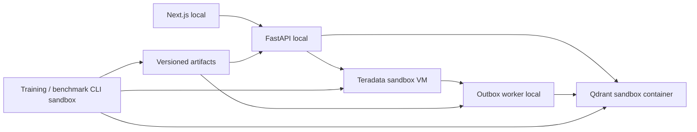

# Tài liệu OfficeLunch

- [Version theo commit](Versioning.md): mã bản build trên FE/API và quy trình build/deploy.

- [Teradata](Teradata.md): SQL, kiến trúc và sandbox.
- [Qdrant](Qdrant.md): vector và vai trò trong ứng dụng.
- [Backend/API](API.md): endpoint, lỗi và trạng thái đồng bộ.
- [Kết quả và trạng thái nghiệm thu](Results.md): số đo thực và các bước đã xác minh.
- [Lịch sử triển khai](History.md): thay đổi, sự cố và bằng chứng theo ngày.
- [Vận hành và phục hồi](Operations.md): kiểm tra kết nối, reboot và đổi model.
- [Deploy native sandbox](../deploy/sandbox/README.md): Supervisor, cổng 18300/8002 và kiểm chứng.
- [Biên bản deploy 06-11](Deployment-2026-11-06.md): commit, build, process, health và SSH tunnel.
- [Sự cố Teradata 02-11](Incident-2026-11-02.md): bằng chứng lỗi WAL và phạm vi bị chặn.
- [Chẩn đoán phục hồi 06-11](Teradata-Recovery-2026-11-06.md): snapshot, thử trên bản sao và lựa chọn phục hồi.
- [Dựng lại Teradata 06-11](Teradata-Rebuild-2026-11-06.md): ủy quyền reset, import/model và kiểm chứng hệ thống mới.
- [Benchmark](Benchmark.md): Trans2Vec, chống leakage và giới hạn kết luận.
- [Vận hành](../backend/README.md): local Compose, native sandbox CLI và artifact.

Dữ liệu nghiên cứu giữ mã item/yes-no gốc; tên món, giá, user và ngữ cảnh demo
được đánh dấu synthetic. Đây không phải bằng chứng về ý nghĩa thực của mã item.
